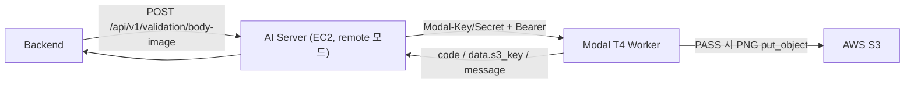

# Modal T4 전신 이미지 검증 Worker

AI Server(EC2)가 remote 모드에서 호출하는 전신 사진 검증 HTTP API 다.
Modal T4 컨테이너 하나에서 CPU(입력 검사·MediaPipe·밝기·PNG)와 GPU(JPEG decode·resize·rembg)를 함께 처리하고,
검증에 성공한 결과 PNG 를 S3 에 올린 뒤 응답한다.



검증 로직은 `app/` 의 router·service·runtime 을 그대로 쓴다. 요청·응답·오류 코드·HTTP status 는
EC2 AI Server 의 같은 endpoint 와 같다(`tests/test_body_image_worker_api.py` 가 같은 계약 테스트를 두 앱에 돌린다).

## 파일

| 파일 | 역할 |
|---|---|
| `deploy/modal/body_image_worker.py` | Modal 이미지·자원·secret·초기화 순서·HTTP 엔드포인트 정의 |
| `app/body_image_validation/worker.py` | Modal 없이 테스트할 수 있는 worker 앱(FastAPI)과 초기화 단계 |
| `app/body_image_validation/gpu_preprocessing.py` | GPU JPEG fast path + Pillow fallback 판단 |

## 자원과 cold start

| 항목 | 값 |
|---|---|
| GPU / CPU / RAM | T4 / 4 core / 8192MiB |
| `scaledown_window` / `min_containers` | 30초 / 0 |
| 컨테이너당 동시 요청 | 1 (Modal 기본값) |
| Memory snapshot | 일반 snapshot 사용, GPU snapshot 미사용 |
| Numba cache | 이미지 빌드 때 `NUMBA_CPU_NAME=generic` 으로 `/opt/numba_cache` 생성 |

초기화 순서:

1. `@modal.enter(snap=True)` — 라이브러리 import(numpy·Pillow·OpenCV·MediaPipe·ONNX Runtime·rembg·torch),
   MediaPipe Person/Pose 생성. CUDA 를 초기화하지 않고 secret 이 담긴 설정도 읽지 않는다.
2. `@modal.enter(snap=False)` — snapshot 복원 뒤 매번. `onnxruntime.preload_dlls()`, S3 client,
   rembg CUDA session, GPU 전처리(CUDA context) 생성, S3 없이 합성 이미지로 전 단계 warm-up.
3. 첫 요청을 받는다.

## Modal Secret

이름 기본값 `lookddak-body-image-worker` (`BODY_IMAGE_WORKER_SECRET_NAME` 으로 바꿀 수 있다).

| 키 | 필수 | 설명 |
|---|---|---|
| `INTERNAL_API_KEY` | O | Backend 가 `Authorization: Bearer <key>` 로 보내는 값. 없으면 모든 요청 401 |
| `S3_BUCKET` | O | 결과 PNG 버킷. 없으면 요청이 500 `S3_CONFIG_ERROR` |
| `AWS_REGION` | - | 기본 `ap-northeast-2` |
| `AWS_ACCESS_KEY_ID` / `AWS_SECRET_ACCESS_KEY` | O | boto3 표준 credential chain 으로 읽는다(EC2 IAM Role 이 없으므로) |

```bash
modal secret create lookddak-body-image-worker \
  INTERNAL_API_KEY=... S3_BUCKET=... AWS_REGION=ap-northeast-2 \
  AWS_ACCESS_KEY_ID=... AWS_SECRET_ACCESS_KEY=...
```

`AUTH_DISABLED=1` 이 들어 있으면 worker 가 시작을 거부한다.

S3 권한은 `s3:PutObject` on `arn:aws:s3:::<bucket>/body-images/*` 만 필요하다. 키는 요청마다
`body-images/<uuid4>.png` 이다(EC2 와 같음). 같은 사진을 다시 보내면 새 키로 다시 저장된다.

## 배포 시 바꿀 수 있는 값 (로컬 환경변수, `modal deploy` 시점)

| 변수 | production 기본값 | staging 기본값 | 용도 |
|---|---|---|---|
| `BODY_IMAGE_WORKER_STAGE` | `production` | `staging` | 배포 대상. `staging` 이면 `max_containers=1`, GPU `["T4", "L4"]`(T4 우선, 없으면 L4). production 은 `T4` |
| `BODY_IMAGE_WORKER_APP_NAME` | `lookddak-body-image-worker` | `lookddak-body-image-worker-staging` | Modal app 이름 |
| `BODY_IMAGE_WORKER_LABEL` | `lookddak-body-image` | `lookddak-body-image-staging` | URL 의 label |
| `BODY_IMAGE_WORKER_SECRET_NAME` | `lookddak-body-image-worker` | `lookddak-body-image-worker-staging` | Modal Secret 이름 |
| `BODY_IMAGE_WORKER_PROXY_AUTH` | `true` | `true` | Modal proxy auth (`false` 는 테스트에서만) |

- 이름 변수를 지정하면 기본값 대신 그 값을 쓴다(빈 문자열은 지정하지 않은 것으로 본다).
- `BODY_IMAGE_WORKER_STAGE=staging` 인데 app 이름이나 label 이 production 값이면 배포 전에 오류로 멈춘다.
- `STAGE` 없이 이름 변수만 바꾸면 production 설정(`max_containers` 제한 없음)으로 배포된다.
  staging 은 반드시 `BODY_IMAGE_WORKER_STAGE=staging` 으로 배포한다.

컨테이너 안 환경변수(`WORKER_ENV`): `BODY_IMAGE_GPU_PREPROCESSING=true`,
`BODY_IMAGE_REMBG_PROVIDERS=CUDAExecutionProvider,CPUExecutionProvider`, `NUMBA_CPU_NAME=generic`,
`NUMBA_CACHE_DIR=/opt/numba_cache`, `REMBG_HOME`/`BODY_IMAGE_MODEL_DIR=/app/models/body_image_validation`.
EC2 이미지(Dockerfile)는 두 플래그가 기본값(꺼짐/rembg 기본 provider)이라 동작이 바뀌지 않는다.

## Staging 배포

```bash
# 저장소 루트에서. Secret 은 미리 만든다(이름: lookddak-body-image-worker-staging).
modal secret create lookddak-body-image-worker-staging INTERNAL_API_KEY=... S3_BUCKET=... ...
BODY_IMAGE_WORKER_STAGE=staging modal deploy deploy/modal/body_image_worker.py
```

staging 은 app `lookddak-body-image-worker-staging`, label `lookddak-body-image-staging`,
Secret `lookddak-body-image-worker-staging`, `max_containers=1` 로 배포된다. 나머지 자원·이미지·초기화는 production 과 같다.

첫 배포는 이미지 빌드(의존성·모델·Numba cache)와 snapshot 생성 때문에 오래 걸린다.
빌드 로그에 `numba cache index files: N` (N>0) 이 찍혀야 한다.

## AI Server 호출

Backend 는 지금처럼 AI Server(EC2)의 `POST /api/v1/validation/body-image` 를 부른다. AI Server 를
`BODY_IMAGE_VALIDATION_MODE=remote` 로 띄우면 모델을 올리지 않고 같은 요청을 worker 로 넘긴다
(`app/body_image_validation/remote.py`). worker 는 항상 local 모드이며 remote 로 뜨면 시작을 거부한다.

```
POST https://<workspace>--<label>.modal.run/api/v1/validation/body-image
Modal-Key: <BODY_IMAGE_REMOTE_PROXY_KEY>
Modal-Secret: <BODY_IMAGE_REMOTE_PROXY_SECRET>
Authorization: Bearer <BODY_IMAGE_REMOTE_API_KEY>   # worker Secret 의 INTERNAL_API_KEY
Content-Type: multipart/form-data; field "image"
```

| AI Server 환경변수 | 내용 |
|---|---|
| `BODY_IMAGE_VALIDATION_MODE` | `local`(기본) / `remote` |
| `BODY_IMAGE_REMOTE_URL` | worker base URL (https 만) |
| `BODY_IMAGE_REMOTE_PROXY_KEY` / `_SECRET` | Modal 대시보드(Settings → Proxy Auth Tokens)에서 만든 token |
| `BODY_IMAGE_REMOTE_API_KEY` | worker Secret 의 `INTERNAL_API_KEY` (Backend→AI Server 키와 다르게 둘 수 있다) |
| `BODY_IMAGE_REMOTE_TIMEOUT_SECONDS` | 기본 90. 연결·전송·대기·읽기 각 단계의 상한(남은 deadline 보다 길게 쓰이지 않음) |
| `BODY_IMAGE_REMOTE_TOTAL_DEADLINE_SECONDS` | 기본 90. 요청을 받은 시점부터(대기열 대기 포함) 최종 응답까지 전체 상한. 운영 예: 50, staging 예: 200 (+ TIMEOUT 180) |
| `BODY_IMAGE_MAX_QUEUE_WAIT_SECONDS` | 기본 10. 대기열에서 실행 슬롯을 기다리는 최대 시간. 넘으면 429 `SERVER_BUSY`, deadline 이 먼저 끝나면 504 |

150초가 넘으면 Modal 은 같은 URL 에 결과 조회 query 를 붙여 303 을 보낸다. AI Server 는 같은 https origin 의
303 만 GET(본문 없음)으로 따라가고(최대 5회), 다른 origin·301/302/307/308 은 따라가지 않고 502 로 끝낸다.

응답: worker 의 성공(`data.s3_key`)과 공통 형식 오류(400/413/422/429/500)는 code·message·status 그대로 전한다.
worker 에 닿지 못하면(연결 실패·503) 503, 정상 worker 응답이 아니면(공통 형식이 아님, 200 인데 `s3_key` 없음,
proxy·worker 인증 실패, 404/405, 502) 502 로 둘 다 `BODY_IMAGE_WORKER_UNAVAILABLE`, 시간 초과(504 포함)는
504 `BODY_IMAGE_WORKER_TIMEOUT` 이다. 인증 실패는 로그에 어느 층(proxy / worker bearer)인지 남긴다(키 값은 남기지 않음).
**재시도하지 않는다**(재요청은 같은 사진을 다시 처리하고 S3 에 한 번 더
올린다). 시간 초과여도 worker 가 처리를 끝내 S3 에 객체가 남았을 수 있다.
AI Server 는 요청 전에 헤더 검사(크기·형식·해상도)를 해서 잘못된 파일로 T4 를 깨우지 않는다.

AI Server 는 요청마다 `X-Body-Image-Deadline`(전체 deadline 의 epoch 초)을 보낸다. HTTP 연결을 끊어도 Modal 작업은
취소되지 않으므로(스케줄링 대기 중이던 요청도 나중에 실행된다), worker 가 이 값을 보고 처리 시작 전·배경 제거 전·S3
업로드 전(남은 시간 2초 미만이면)에 스스로 멈추고 504 `BODY_IMAGE_WORKER_TIMEOUT` 을 낸다. 이미 시작한 GPU 추론이나
진행 중인 업로드는 중간에 끊지 않는다. worker 로그: `body image request stopped at <stage>`.

`GET /health` 는 프로세스 생존만 본다(proxy auth 는 필요).

## 테스트

| 위치 | 실행 환경 |
|---|---|
| `tests/test_body_image_worker.py`, `tests/test_body_image_worker_api.py` | 로컬·CI (CPU, fake 모델·S3) |
| `tests/test_body_image_modal_worker.py` | `modal` 패키지가 있을 때 (원격 호출 없음) |
| `tests/test_body_image_gpu_preprocessing_cuda.py` | CUDA 가 있을 때만 (Modal T4) |
